# SkillLoop

SkillLoop is a GenLayer Native contributor exchange. Three independent people can each offer a specific software service and request another. Validators judge whether an offered service covers a requested one. Contract code then finds a closed three-person exchange, reserves its offers together, and lets the three members accept and record delivery.

**Deployed Studionet contract:** [`0xce9A6dFC2401Db01E1224b4E08c82D99e3a3099e`](https://explorer-studio.genlayer.com/address/0xce9A6dFC2401Db01E1224b4E08c82D99e3a3099e). Studionet is a temporary development network; its state can reset.

## What is native here

The contract calls `gl.nondet.exec_prompt` twice: when a member posts an offer, to reject vague commitments, and when anyone reviews a directed giver-to-receiver pair, to decide `FIT`, `NO_FIT`, or `UNCLEAR`. For each nondeterministic call, validators independently repeat the judgment and compare the single state-affecting verdict exactly. Anything ambiguous fails closed. The contract does **not** ask a model to pick winners or handle numeric bookkeeping. It scans reviewed edges in ascending offer-ID order and reserves the first valid three-member cycle atomically.

This differs from the user's prior grant, disclosure, mandate, and obligation concepts: the core state transition is a **three-sided barter clearing mechanism**, built from independently judged directed compatibility edges. No funding, eligibility, or document attestation is involved.

```mermaid
flowchart LR
  A[Member offer: gives + wants] --> J[GenLayer validators: clear or vague]
  J -->|CLEAR| O[Open offer]
  O --> P[Directed pair review]
  P --> V[GenLayer validators: FIT, NO_FIT, UNCLEAR]
  V -->|FIT| E[Stored compatibility edge]
  E --> C[Deterministic three-person cycle scan]
  C --> R[Atomic reservation]
  R --> X[Three member acceptances]
  X --> D[Delivery URLs and receiver confirmations]
```



## Run the app

Requires Node.js and pnpm.

```powershell
pnpm install
pnpm dev
```

Open the local URL shown by Vite. The app starts with the deployed Studionet contract; use **Use sample board** for a clearly labeled browser simulation. The sample judgments are illustrative and do not claim validator proof. A browser wallet with EIP-1193 support is needed for writes. You can point the app at another deployed instance through the Network card or set `VITE_CONTRACT_ADDRESS` at build time.

To build a static frontend:

```powershell
pnpm build
```

The static output is in `dist/`.

## Exchange rules

1. Three different owners post concrete `gives` and `wants` statements. An offer expires 1 to 60 days after posting.
2. Anyone pays to review a directed pair. A reviewed pair cannot be submitted again; `NO_FIT` and `UNCLEAR` do not qualify.
3. Anyone can clear the first eligible three-person cycle. Only reviewed `FIT` edges qualify. The three offers are reserved together.
4. Each owner has two days to accept. A decline releases the other two offers and retires the declining offer. On expiry, nonresponders are retired.
5. Once all accept, members have 14 days to submit HTTPS delivery links. Only the receiver of each service can confirm that delivery. All three confirmations mark the cycle `COMPLETED`.

The contract does not verify that a submitted URL contains the promised work. Confirmation represents the receiver's statement. There is no GEN escrow, payment, dispute resolution, or offchain reputation in this version. Service commitments are public onchain, so members should avoid private information in descriptions and links.

## Source and checks

- `contracts/SkillLoop.py` — contract and view methods.
- `src/main.js` and `src/style.css` — frontend and GenLayer JS integration.
- `tests/test_skillloop.py` — local contract tests covering cycle completion, negative edges, forged leader result, authorization, replay, reverse orientation, deadlines, and vague input.
- `proof/` — Studionet transaction manifest and verification script once the live sequence completes.

To run the contract tests, install `genlayer-test` and `genlayer-py` in a Python environment, then run `gltest -q tests/test_skillloop.py`. The test harness in `testing/` handles a Windows temporary-file quirk in the current local `gltest` version. `genvm-lint check contracts/SkillLoop.py` validates runner compatibility.

## Current network assumptions

This source targets stable Studionet, chain ID 61999, with `genlayer-js` 1.1.8 and the pinned `py-genlayer` runner in the contract header. Do not point the stable SDK preset at a release-candidate Studio environment. Network configuration and transaction finality should be checked against the current [GenLayer network guide](https://docs.genlayer.com/developers/networks) and [write guide](https://docs.genlayer.com/developers/decentralized-applications/writing-data).
